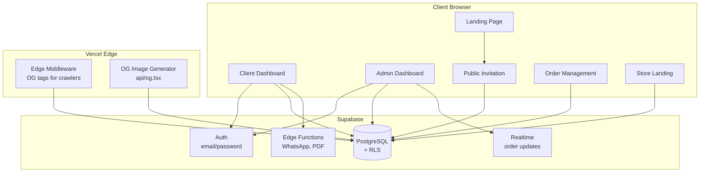
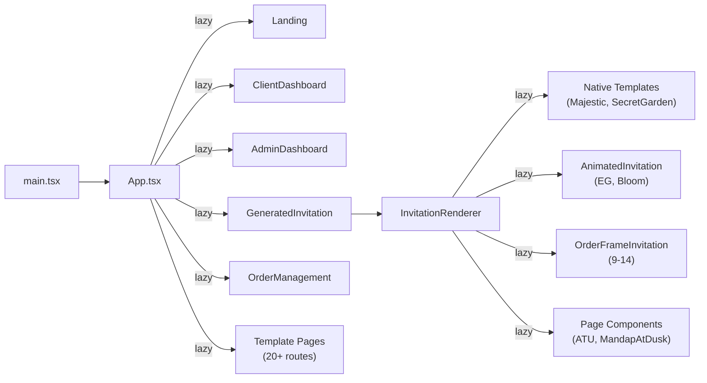
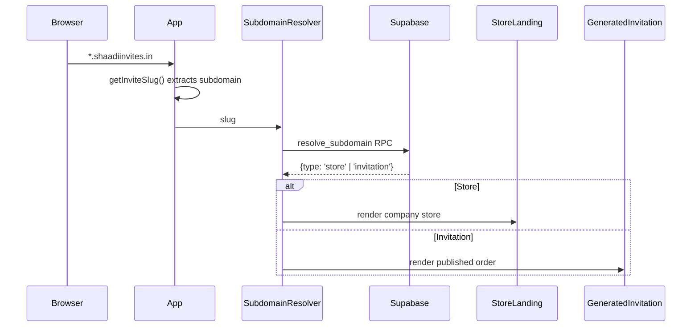
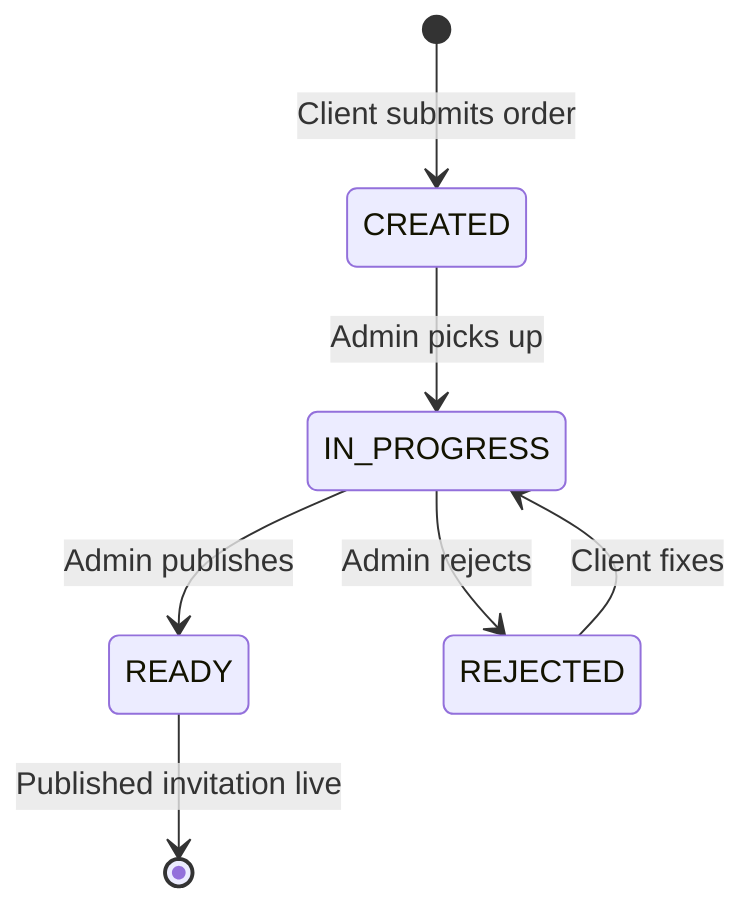
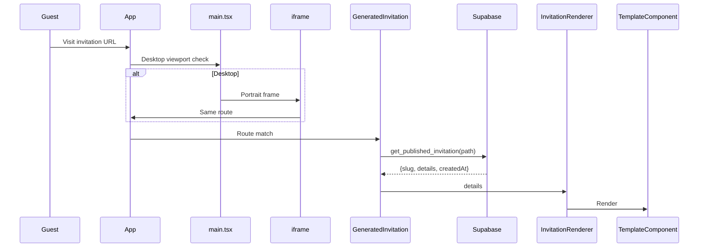

# Architecture

## High-Level Overview



## Frontend Architecture

### SPA with Multiple Entry Points

- **`index.html`** — Main SPA entry for all routes
- **`arjunbhavana.html`** — Dedicated entry for A Timeless Union with sharing metadata

### Route-Level Code Splitting

All pages and templates use `lazy()` imports via `lazySitePage()` wrapper. The wrapper bundles `SiteFonts` with legacy pages automatically. Native templates (Royal Grace, Majestic, Secret Garden) manage their own fonts.



### Desktop Invitation Viewport

`main.tsx` detects public invitation routes on desktop (≥768px) before mounting React. It renders a portrait-shaped iframe (9:16) with ivory surround. The actual React app boots inside the iframe.

### Subdomain Resolution



## Template Rendering Architecture

### Three Template Implementation Types

1. **Native React** (Royal Grace, Majestic, Secret Garden) — Full React components using shared `InvitationLayoutProvider`, `InvitationSection`, `EditableText`, `InvitationMedia`. Own CSS/fonts. Dashboard text editor works natively.

2. **AnimatedInvitation** (Embroidered Garden, Bloom) — Fetches HTML from `public/templates/{name}/index.html`, personalizes DOM via JavaScript, renders in same-origin iframe. Uses `TextLayoutLayer` for text editing.

3. **OrderFrameInvitation** (templates 9–14) — Same-origin iframe loading standalone HTML. Personalized via `orderFrameAdapter.ts`. Uses `TextLayoutLayer` + `legacyTextAdapters.ts` for text editing.

### Template Component Contract

```
InvitationLayoutProvider (validates textOverrides)
  └── InvitationSection (section dimension observation)
       └── EditableText (text with saved size/position/font/color)
       └── InvitationMedia (optimized image/video with priority)
```

### InvitationRenderer Routing Logic

```
template === 2         → Majestic (native)
template === 5         → SecretGarden (native)
template === 1         → MohadRahma (standalone)
template in [9..14]    → TextLayoutLayer > OrderFrameInvitation
template in [3,4,8]    → SiteFonts > TextLayoutLayer > PageComponent
template in [6,7]      → SiteFonts > TextLayoutLayer > AnimatedInvitation
template in [101..117] → SiteFonts > TextLayoutLayer > DeprecatedComponent
```

## Authentication & Authorization

- **Auth provider:** Supabase Auth (email + password)
- **Role assignment:** Admin roles set via Supabase dashboard/service role (`app_metadata.role = 'ADMIN'`)
- **Client identification:** Company email matched to `companies.email`
- **Route guards:** `DashboardAccess` component checks role before rendering

### RLS Policies

- Companies visible to their member + admins
- Templates visible to signed-in users (active only for non-admins)
- Orders visible to owning company + admins
- Clients can only insert orders for their own company
- Only admins can update order status/publishing
- `get_published_invitation` accessible to anon + authenticated

## Data Flow

### Order Lifecycle



### Invitation Rendering Flow



## Deployment Architecture

- **Platform:** Vercel
- **Edge middleware:** `middleware.ts` — generates OG tags for social crawlers on subdomains
- **Edge functions:** `api/og.tsx` — dynamic OG image generation
- **Asset caching:** Immutable caching for JS/CSS/fonts/images (vercel.json)
- **DNS:** Wildcard `*.shaadiinvites.in` → Vercel
- **Supabase:** Separate project for auth, database, edge functions, storage
