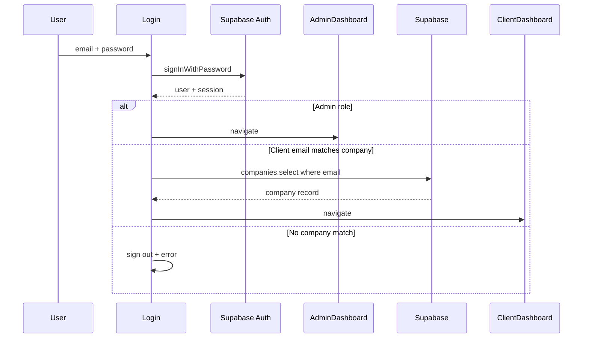
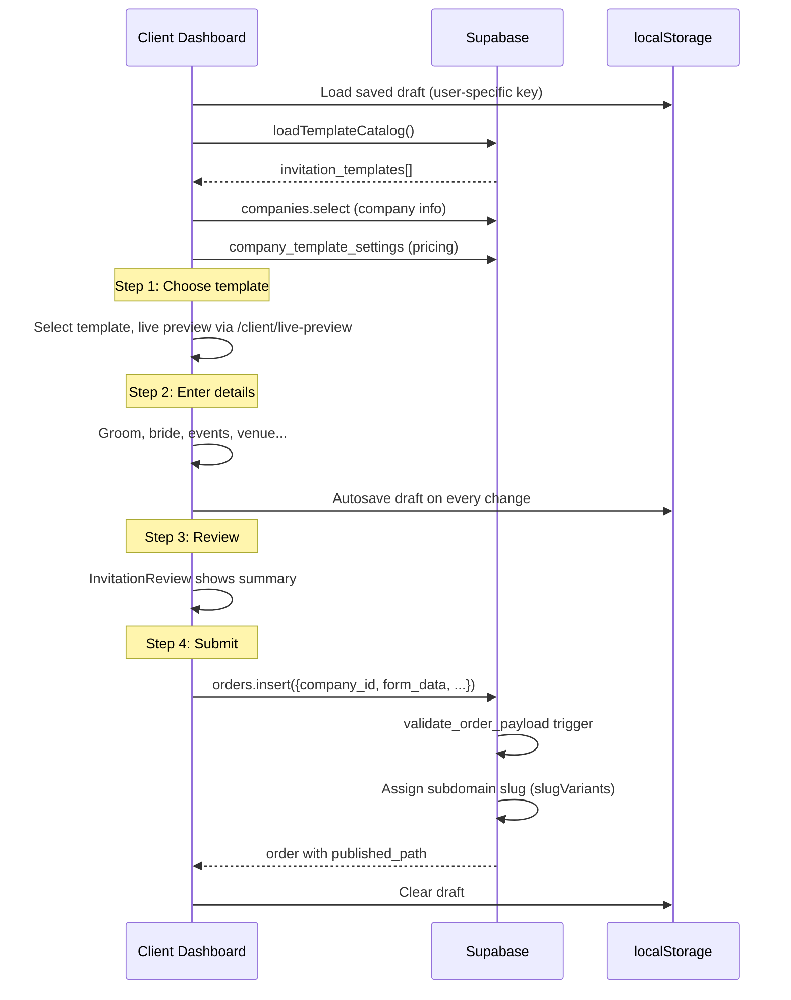
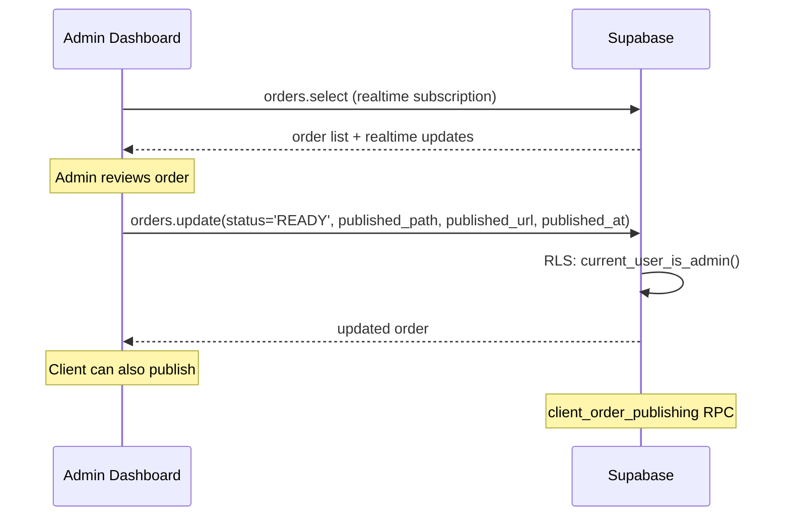
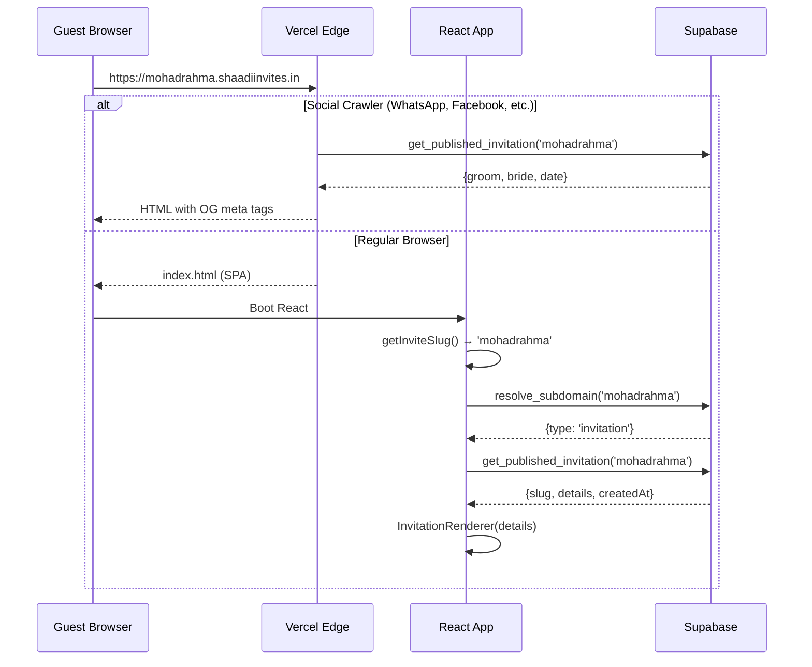
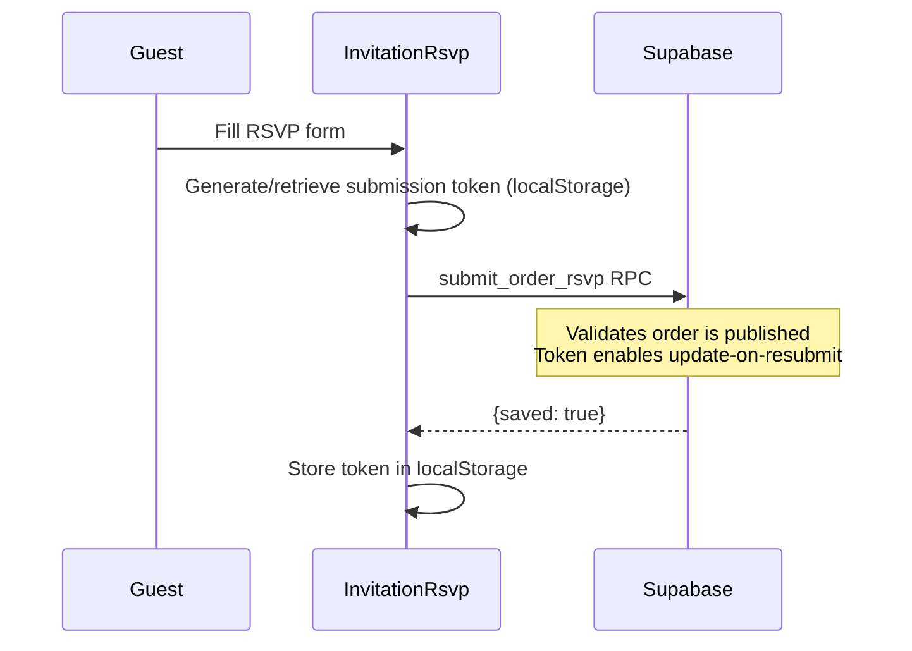
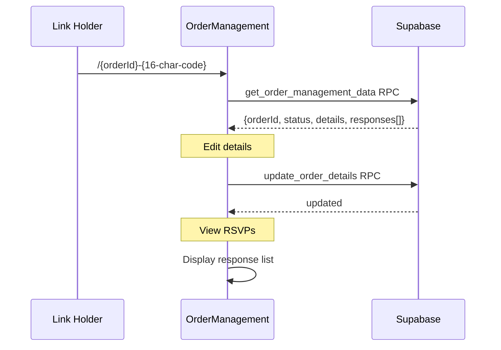
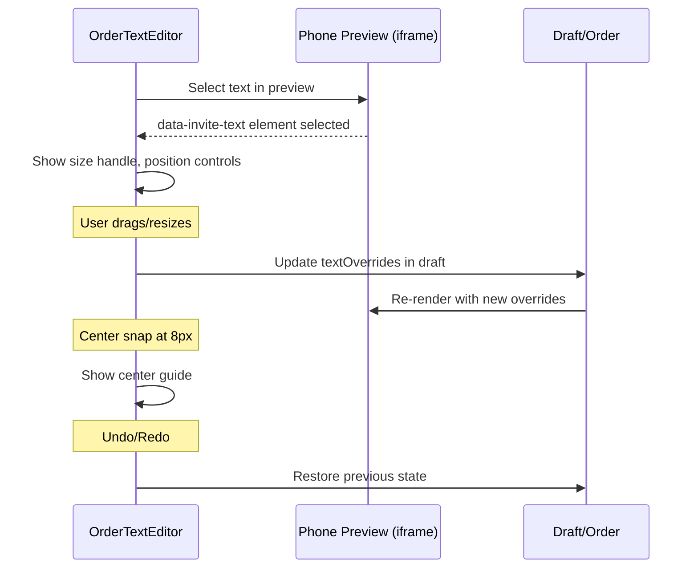
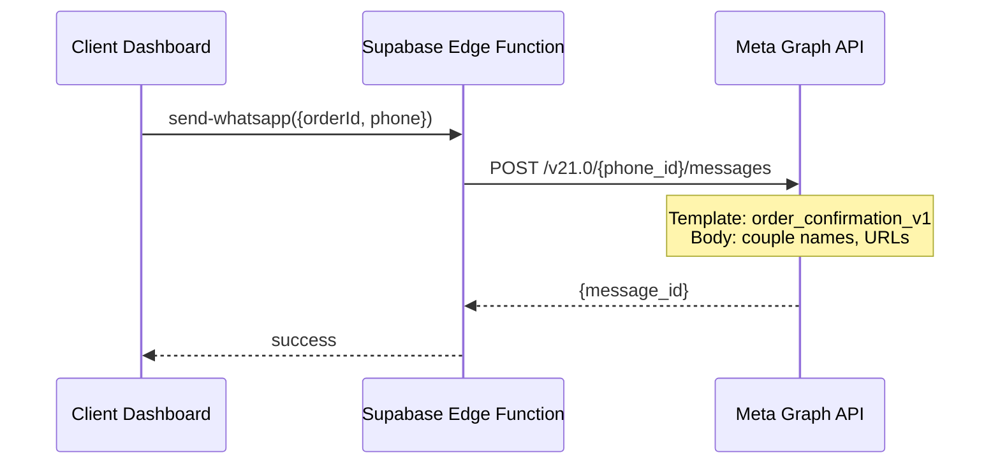
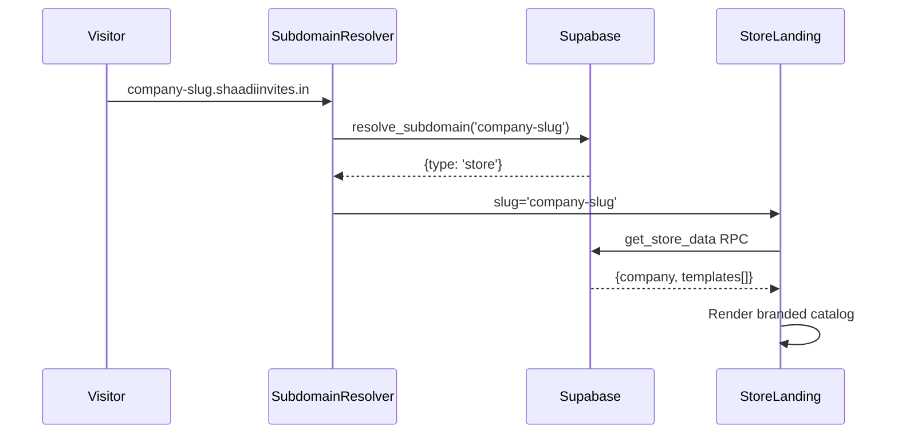

# Data Flow

## Authentication Flow

## Order Creation Flow

## Order Publishing Flow

## Public Invitation Access

## RSVP Submission Flow

## Order Management Flow

## Text Editing Flow (Dashboard)

## WhatsApp Sending Flow

## Store Landing Flow

## Data Storage Summary

| Data | Storage | Mechanism |
|------|---------|-----------|
| Auth session | Supabase Auth | JWT tokens |
| Companies | `companies` table | RLS per company |
| Orders | `orders` table | RLS per company + admin |
| Order details | `orders.form_data` (JSONB) | Validated by trigger |
| Text overrides | `orders.form_data.textOverrides` | Version 1 schema |
| Template catalog | `invitation_templates` table | RLS read access |
| Template pricing | `company_template_settings` table | Per company |
| RSVP responses | `order_rsvps` table | Submission token |
| Draft state | `localStorage` | User-specific key |
| Published invitations | `get_published_invitation` RPC | Security definer |
| Music selection | `orders.form_data.music` | String path/URL |
| Subdomain slugs | `orders` + subdomain reservation | Unique constraint |
| Local dev invitations | `.invitation-data/invitations.json` | File-based |
